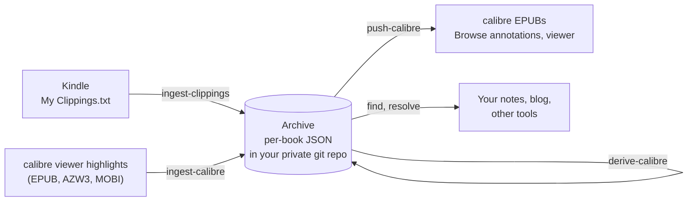
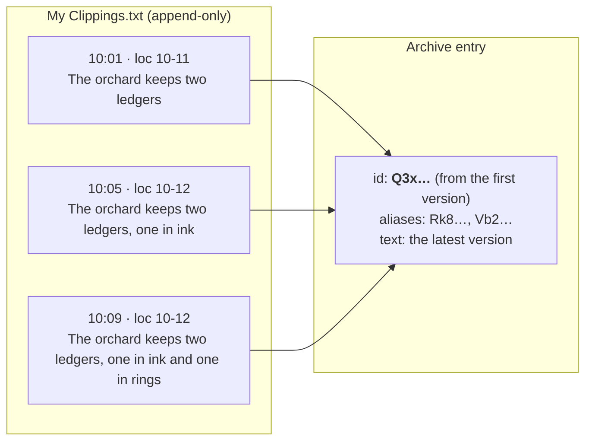
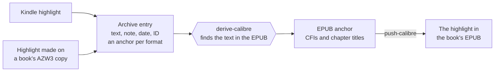

# florilegium

**A permanent, plain-text archive of every highlight and note you make while
reading, with an ID for each one that you can cite for years.**

*Florilegium*, Latin for "a gathering of flowers": the medieval book of
passages copied out of other books. The command is `flor`.

It gathers highlights from your Kindle and from calibre's viewer into one
archive of JSON files in a git repository of your own, places every highlight
in the book's EPUB, and writes them back into calibre so you can browse them
all in one place and read each one in context.



## Why

Reading leaves highlights scattered across devices. The Kindle appends them to
`My Clippings.txt`, a noisy, append-only file in which every edit of a
highlight becomes another entry. calibre keeps its own in a database. Neither is
a record you can build on.

The point of the archive is the **identifier**. Each highlight gets an ID once,
and that ID never changes, so a note in Obsidian or a blog post can cite the
passage instead of copy-pasting it, and the citation still resolves after
re-reads, edits, device resets and library rebuilds.

calibre is not a second record but a **reading interface** onto the archive:
"Browse annotations" lists every highlight under its book and chapter, and the
viewer shows each one in the context of the text around it, including the ones
you made on the Kindle.

## How it works

### One ID per highlight, for good

On a Kindle, extending or trimming a highlight appends a new entry rather than
changing the old one. The archive folds such edit chains into a single entry:
the ID of the first version stays, and every later version's ID becomes an
alias, so a citation made against any of them still lands.



Two highlights count as one edited passage only when their locations touch or
overlap **and** they share a substantial run of text, so neighbouring
highlights that merely share a boundary stay separate. Kindle IDs are
deterministic hashes, so the same clippings file always yields the same IDs;
highlights made in calibre keep calibre's own. Either way an ID is frozen once
written: fixing a bug in the tool never moves one.

### Highlights move between formats

An entry does not belong to the format it came from. It keeps an **anchor** per
book format: calibre's own where calibre holds the highlight, and one the tool
derives for the EPUB by finding the passage's text in the book. That is how a
Kindle highlight, or one made on a book's AZW3 copy, shows up in its EPUB too.



The derived positions (EPUB CFIs) are generated exactly as calibre's viewer
generates them, and chapter titles come from the book's own table of contents,
the same data calibre's viewer uses. Both are checked against highlights made in
calibre itself.

### Every change is a reviewable diff

The archive is plain JSON with a single canonical form: running a command twice
with nothing new changes zero bytes, and syncing new highlights changes only the
entries they touch. There are no prompts or conflict dialogs; you review what
the tool did with `git diff`, and commit it or not.

## Quick start

You need [Rust](https://rustup.rs) and [just](https://github.com/casey/just).
The calibre commands need [calibre](https://calibre-ebook.com) installed, and
`just find` needs [fzf](https://github.com/junegunn/fzf).

1. Give the archive a folder of its own in a **private** git repository (next to
   a backup of your clippings file works well).
2. Copy `.env.example` to `.env` (it is gitignored) and set three paths: the
   archive folder, your `My Clippings.txt` and your calibre library.
3. Build the archive from your Kindle, then check it:

   ```bash
   just ingest-clippings --dry-run   # see what would be written
   just ingest-clippings
   just check
   ```

4. Bring in calibre and put everything into calibre's EPUBs:

   ```bash
   just ingest-calibre
   just derive-calibre
   just push-calibre --dry-run
   just push-calibre --calibre-closed   # with calibre quit
   ```

After the next Kindle sync, run the same commands again: only what changed
shows up in the diff. Run `just` to list every recipe and
`flor <command> --help` for each command's options (`cargo install --path .`
puts `flor` on your PATH).

## Citing a highlight from anywhere

`just find` opens a fuzzy search over every entry's book, chapter, text and note,
shows the full entry as you move, and copies the chosen entry's ID to the
clipboard. Paste that ID wherever you cite the passage.

Any tool can turn IDs back into clippings with `resolve`, which takes any number
of IDs, current or old aliases, and prints one JSON object per line in a stable,
versioned shape:

```bash
flor resolve Q3xk9w2LmT7vPq1aZr5sYb --json
```

```json
{"version":1,"queried":"Q3xk9w2LmT7vPq1aZr5sYb","status":"found","id":"Q3xk9w2LmT7vPq1aZr5sYb",
 "book":{"title":"The Orchard Ledger","authors":["Mara Penn"],"calibre_uuid":"…"},
 "chapter":["Part One","Rings"],"type":"highlight",
 "text":"The orchard keeps two ledgers, one in ink and one in rings","note":null,
 "created":"2026-01-04T08:09:00.000Z","location":[10,12],"page":null,"claimants":[]}
```

`status` is `found`, `deleted`, `unknown` or `ambiguous`, and the exit code is
non-zero if any ID did not resolve cleanly. How a clipping is displayed, as a
quote, a link or Markdown, is up to the tool that asked.

## Principles

- **The archive is the source of truth.** The Kindle file and calibre feed it;
  calibre and everything downstream read from it.
- **Identity is minted once and frozen.** Text, positions and match quality may
  change; an ID may not. When two entries turn out to be the same passage, the
  loser's ID is kept as an alias, so no citation ever breaks.
- **Review by diff.** Same inputs give byte-identical output. The tool can
  afford to be opinionated because every change it makes is visible in
  `git diff`.
- **Derived data never touches identity.** Anything recomputable (the calibre
  book match, CFIs, chapter titles) can be regenerated without moving an ID.
- **Judgment lives in one place.** Only the Kindle file needs overlap-based
  deduplication, because only it records edits as new entries. Everywhere else
  matches by ID alone.
- **Careful with calibre's library.** Read freely; write rarely, with a backup,
  only with calibre closed, and only what the tool is confident about.
  Ambiguous or approximate placements are pushed only when you ask.
- **Public tool, private data.** This repository never contains real clippings,
  book text or notes, including in test fixtures. Your archive lives in a
  private repository of your own.

## Scope and limits

- The Kindle and calibre come first. Other readers (Kobo, for example) are meant
  to plug in later as further sources of the same archive.
- calibre is only ever written to on **EPUB**. Convert a book to EPUB in calibre
  to see its highlights there; the tool never converts or modifies a book.
- No GUI, no syncing back to the Kindle, and no automatic detection of deleted
  highlights: mark a deletion in the archive by hand and review it in the diff.
- English Kindle clippings work out of the box; other languages need their
  keywords and date format in the archive's `config.toml`.

## Development

Everything runs through `just`: `just test` runs the test suite, which needs
neither calibre nor Python, and `just test-calibre` the tests that drive a real
calibre install. The tool is written in Rust; the one piece of Python is the
short script that writes annotations through calibre's own code, run by
calibre's bundled interpreter. Planned work lives in [BACKLOG.md](BACKLOG.md),
and the reasons behind past decisions in the commit history.
